# Bare Vibes

A collection of small games built on [Bare Engine](https://github.com/bare-engine/bare-engine).

Bare is designed to be easy and intuitive for developers, but it's also a good fit for AI coding agents.

**Here every game  was built by an AI agent.** They're here to put the engine to the test: each one leans on a different part of it (physics, tilemaps, rendering at scale, UI, input, save data, audio), and together they show how well an agent can pick up Bare and turn it into something playable.

Click a screenshot to play the built version.

<table>
<tr>
<td align="center" width="50%">
<a href="https://bare-engine.github.io/bare-vibes/BareFactorio/dist/">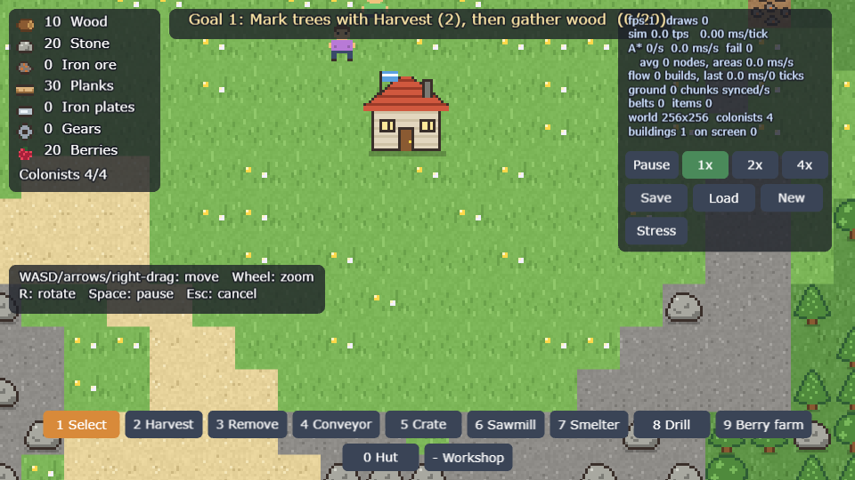</a><br>
<b><a href="https://bare-engine.github.io/bare-vibes/BareFactorio/dist/">BareFactorio</a></b><br>
A colony and automation sim with colonists, drills and conveyor belts.
</td>
<td align="center" width="50%">
<a href="https://bare-engine.github.io/bare-vibes/BareVamireSurvivors/dist/">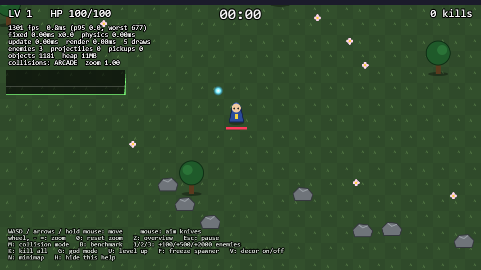</a><br>
<b><a href="https://bare-engine.github.io/bare-vibes/BareVamireSurvivors/dist/">Bare Vampire Survivors</a></b><br>
A Vampire Survivors-style game that stress-tests rendering and physics.
</td>
</tr>
<tr>
<td align="center" width="50%">
<a href="https://bare-engine.github.io/bare-vibes/BareTowerDefense/dist/">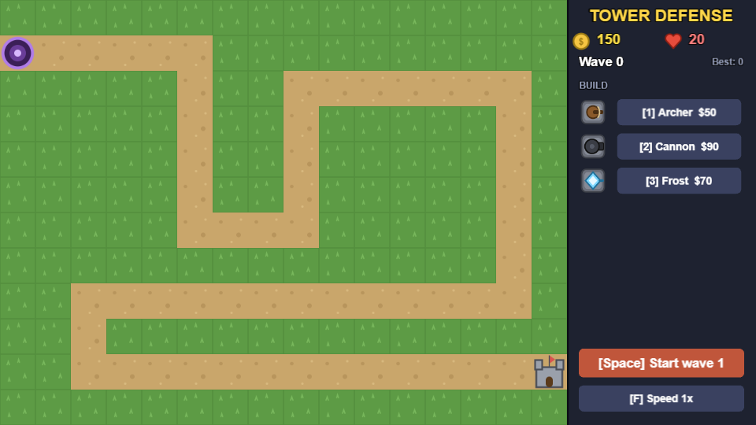</a><br>
<b><a href="https://bare-engine.github.io/bare-vibes/BareTowerDefense/dist/">Tower Defense</a></b><br>
Build archer, cannon and frost towers to hold off the waves.
</td>
<td align="center" width="50%">
<a href="https://bare-engine.github.io/bare-vibes/BareRace/dist/">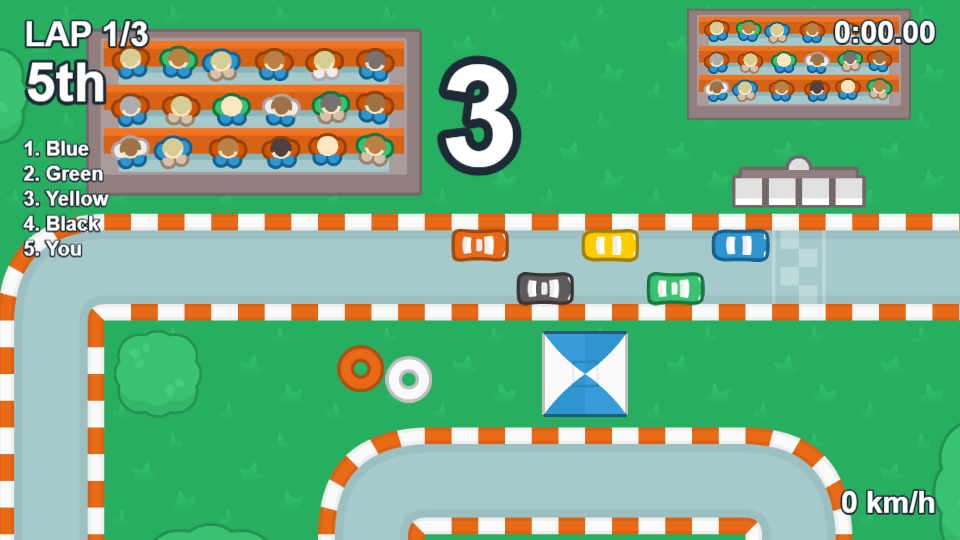</a><br>
<b><a href="https://bare-engine.github.io/bare-vibes/BareRace/dist/">BareRace</a></b><br>
A top-down racer against four AI drivers.
</td>
</tr>
<tr>
<td align="center" width="50%">
<a href="https://bare-engine.github.io/bare-vibes/BareTetris/dist/">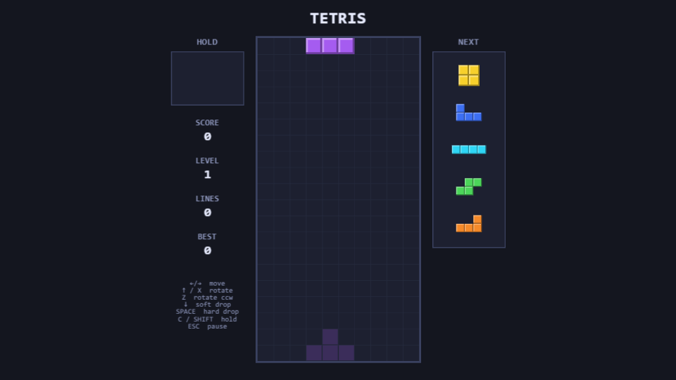</a><br>
<b><a href="https://bare-engine.github.io/bare-vibes/BareTetris/dist/">Tetris</a></b><br>
Tetris with hold, next queue and hard drop.
</td>
<td align="center" width="50%">
<a href="https://bare-engine.github.io/bare-vibes/BareGolf/dist/">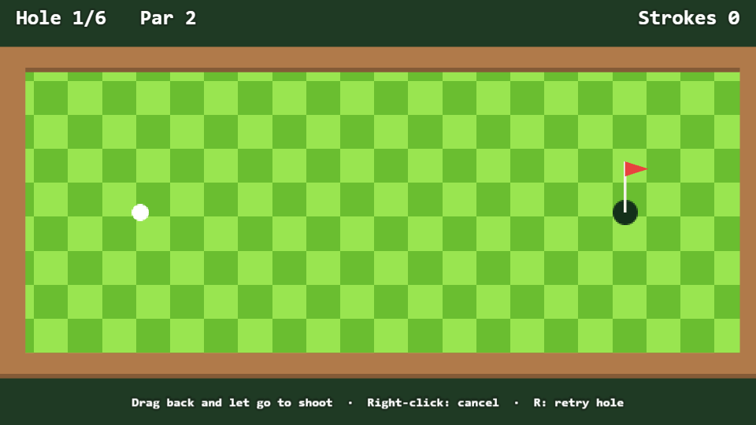</a><br>
<b><a href="https://bare-engine.github.io/bare-vibes/BareGolf/dist/">BareGolf</a></b><br>
Six holes of drag-and-shoot mini golf.
</td>
</tr>
<tr>
<td align="center" width="50%">
<a href="https://bare-engine.github.io/bare-vibes/BareMetroidvania/dist/">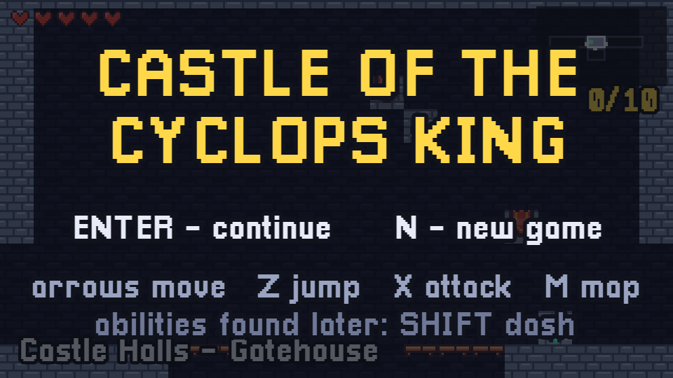</a><br>
<b><a href="https://bare-engine.github.io/bare-vibes/BareMetroidvania/dist/">Castle of the Cyclops King</a></b><br>
A metroidvania: 52 rooms, ability gates, a map and a boss.
</td>
<td align="center" width="50%">
<a href="https://bare-engine.github.io/bare-vibes/BareZelda/dist/">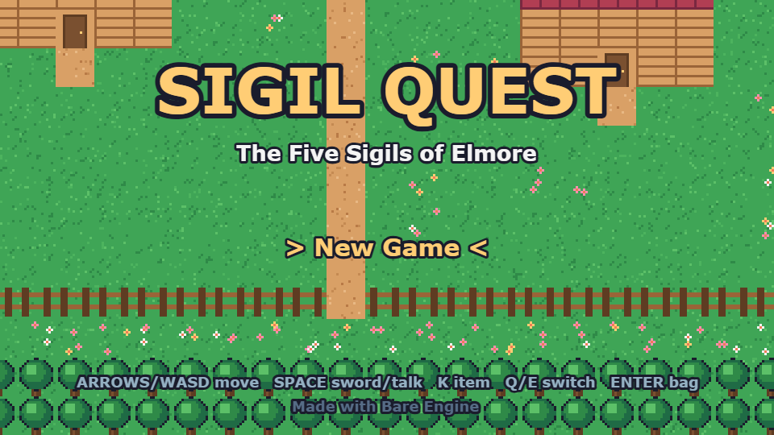</a><br>
<b><a href="https://bare-engine.github.io/bare-vibes/BareZelda/dist/">Sigil Quest</a></b><br>
A top-down action RPG in the style of early Zelda, with five dungeons.
</td>
</tr>
<tr>
<td align="center" width="50%">
<a href="https://bare-engine.github.io/bare-vibes/BareRedRemover/dist/">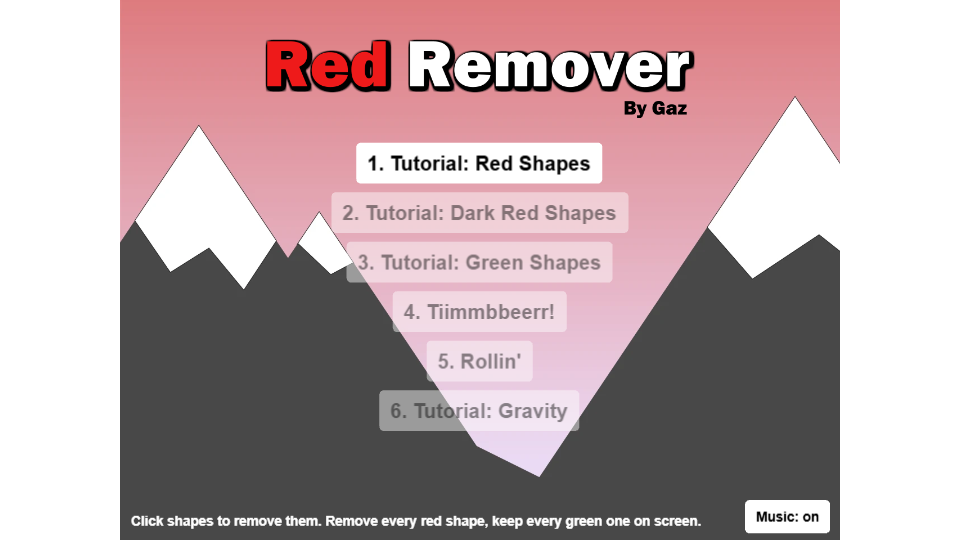</a><br>
<b><a href="https://bare-engine.github.io/bare-vibes/BareRedRemover/dist/">Red Remover</a></b><br>
A physics puzzler remake of the Flash game: remove the red shapes, keep the green.
</td>
<td align="center" width="50%">
<a href="https://bare-engine.github.io/bare-vibes/BareJumper/dist/">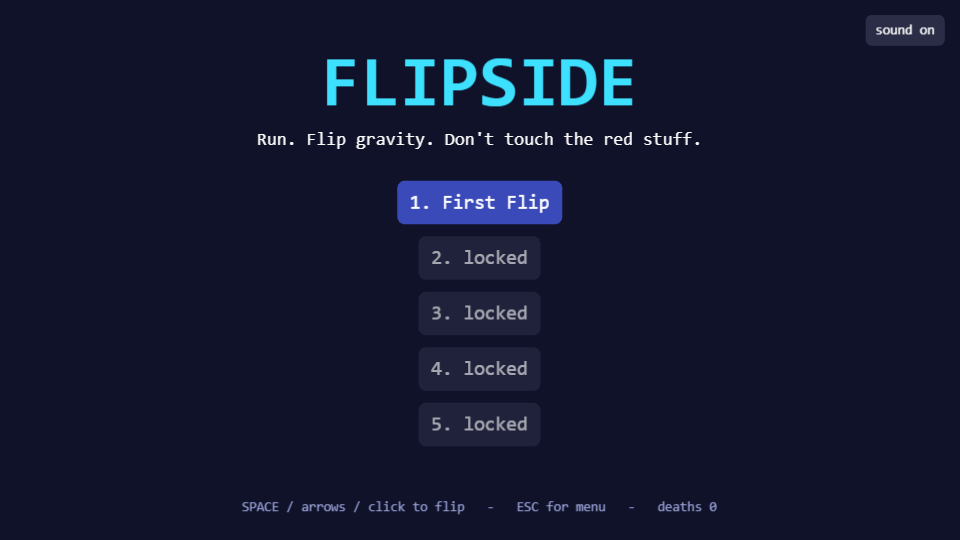</a><br>
<b><a href="https://bare-engine.github.io/bare-vibes/BareJumper/dist/">Flipside</a></b><br>
A one-button gravity-flip runner with ghost replays of your best run.
</td>
</tr>
<tr>
<td align="center" width="50%">
<a href="https://bare-engine.github.io/bare-vibes/BareSokoban/dist/">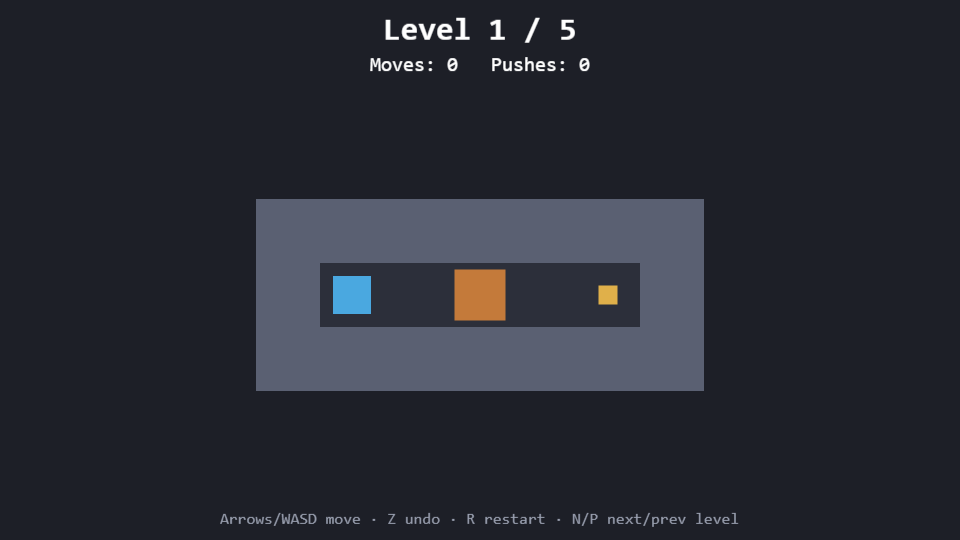</a><br>
<b><a href="https://bare-engine.github.io/bare-vibes/BareSokoban/dist/">Sokoban</a></b><br>
Box-pushing puzzles with undo.
</td>
<td align="center" width="50%">
<a href="https://bare-engine.github.io/bare-vibes/BareSnake/dist/">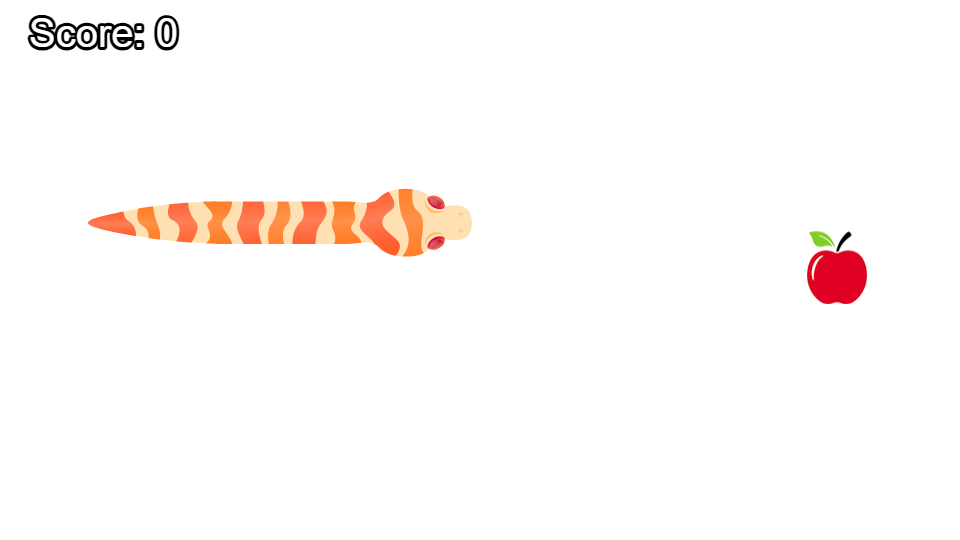</a><br>
<b><a href="https://bare-engine.github.io/bare-vibes/BareSnake/dist/">BareSnake</a></b><br>
Snake, with a smooth bendy body.
</td>
</tr>
</table>

## Running locally

The `dist` builds load their data with `fetch`, so open them through a web server instead of straight from disk. From this folder:

```sh
npx serve .
```

Then go to e.g. `http://localhost:3000/BareZelda/dist/`.

To work on a game, go into its folder and run:

```sh
npm install
npm run dev
```
